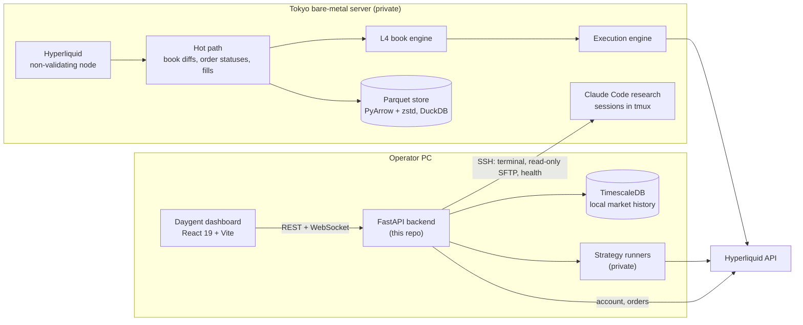

# Daygent — Operator Dashboard

**A React/Vite control panel for a self-hosted Hyperliquid trading stack: operating, charting, and visualizing.**

This repository is the **front end and local API layer only**. The systems it operates are private and live elsewhere: the Hyperliquid node, market data, L4 book engine, execution engine, strategies, and research code. Most of it runs on a dedicated bare-metal server in Tokyo. Daygent is where I watch markets, inspect order-book structure, review strategy trades, manage positions, and drive research sessions on that server.

    

---

## What lives where

| | In this repo (public) | Private |
| :--- | :--- | :--- |
| **Interface** | React 19 + Vite dashboard (25 tabs) | — |
| **API** | FastAPI routers the dashboard calls (`backend/`) | Shared Hyperliquid client, signing keys, proxy config |
| **Data** | — | Node streams, Parquet store (~370 GB), TimescaleDB history |
| **Engines** | — | L4 book engine, execution engine, strategy runners |
| **Research** | Visualizations of research output | All research code, models, and results |

Keys and configuration are never stored here: the backend reads them from files outside the repository at runtime.

---

## Architecture



### The private infrastructure Daygent operates

**Self-hosted Hyperliquid L1 node + execution engine.** This is a non-validating node on a dedicated Tokyo bare-metal server (16 threads, 128 GB RAM, NVMe), sized to the network's peer requirements. Its history was backfilled via QuickNode. The stack targets HIP-3 growth-mode markets, where fees run about 80% below standard.

- **Data pipeline.** A real-time hot path reads the node's unbuffered block-by-block streams: raw book diffs, order statuses, and fills. An asyncio/WebSocket collector adds 1-second mark, oracle, funding, and open-interest data on 347 perps. The cold path is a PyArrow/zstd Parquet store (~370 GB) queried with DuckDB.
- **L4 book engine.** This deterministic, block-level book tracks every order's owner, queue position, and lifecycle. Live signals and replay simulation share it, and it shows zero diffs against node snapshots.
- **Execution engine.** It quotes event-driven, block by block, with SDK-signed ALO post-only orders, re-posting, and a taker fallback. Its state is persisted, and it restarts automatically under supervision. A peer watchdog keeps the node at the chain tip.
  - *TWAP-based, HIP-3 equity/commodity perps:* about 10 bps net per trade vs 1.8 bps in fees, a ~55% hit rate, and tens of events per day.
  - *Closed-market maker, Asian-underlying HIP-3 names:* an example fill made about 3 bps net (SKHX) vs a ~0.05 bps maker fee. It quotes every closed session.

---

## Dashboard tour

### Trading operations
| Tab | What it does |
| :--- | :--- |
| **Hyperliquid** | Account, live positions with the exchange's liquidation price, open orders, transfers, and a strategy-runner panel. The trading station estimates the liquidation price before an order, then shows the exchange's actual figure after. |
| **Ranker** | Operates a 10-slot cross-sectional long/short runner: arm, disarm, flatten, and retrain. It shows runner, collector, and model health, the live book, this hour's candidates, realized stats, the equity curve, and recent trades. |
| **BTC Play** | One-button price triggers. A runner watches the BTC mid and fires a pre-set long when price crosses down through a level. |

### Charting and market microstructure
| Tab | What it does |
| :--- | :--- |
| **BXT Viz** | Mid-price OHLC candles stacked from stored 5-second book/trade buckets. It overlays order-book walls, taker flow, and L20 depth, and has draggable chart panes, hotkeys, and pop-out "breakout" chart tabs. |
| **SOL OI Viz** | The BXT visualizer pointed at a strategy's trade log. You pick a strategy, step through its trades, and the chart jumps to each one with the entry and exit marked. |
| **Deriv BXT / L2 Deep** | Per-day calendars and day-detail views of bucketed book/trade data and deep L2 order-book snapshots. |
| **SOL / BTC / ETH / SPX** | Per-perp live views: ticks, trades, and marks streamed from Postgres `pg_notify` to the browser over WebSockets, plus history calendars. |
| **Strat Hub** | Builds feature bundles for any asset and time window, then sends them to an LLM for structured analysis, with selectable model and reasoning effort. |
| **DataBento** | ES futures outrights and calendar spreads: trading calendar, volume-ranked instruments, intraday and large-trade microstructure, and roll activity. |

### Server operations
| Tab | What it does |
| :--- | :--- |
| **Server CCode** | A live terminal to Claude Code research sessions on the Tokyo server (xterm.js over a WebSocket, sessions in tmux). It starts, switches, and resumes chats, with per-chat model/effort controls and a context and compaction meter. It also has a read-only server file browser over SFTP and an on-demand server health panel. Every route is restricted to this machine and the local dashboard origin. |

### Earlier research tabs
**Data, Vector, Chart, Backtest, LLM, Pipeline, Model, Features, V6, Delta, IMC P4.** Most of these come from the project's first phase: SPY/ES/EURUSD candles in PostgreSQL, BERT and isolation-forest candle embeddings with similarity search, and LightGBM model training and backtest replay. They also include pipeline and training launchers, plus analysis views for the IMC Prosperity 4 trading competition.

---

## Tech stack

| Layer | Tools |
| :--- | :--- |
| **Front end** | React 19, Vite 6, Tailwind CSS 4, TradingView lightweight-charts v5 (multi-pane), Recharts, xterm.js |
| **Local API** | Python, FastAPI, asyncio, WebSockets, SQLAlchemy, PostgreSQL / TimescaleDB with `pg_notify` streaming, asyncssh (SSH, SFTP, tmux) |
| **Private stack** | Hyperliquid node + Python SDK, PyArrow, Parquet/zstd, DuckDB, LightGBM, Numba, multiprocessing, systemd, Linux |

---

## Repository layout

```
src/
  App.jsx, main.jsx            app shell, theme, breakout-chart routing
  components/
    TradingDashboard.jsx       tab bar and dashboard router
    BxtVisualizer.jsx          candle/wall/flow chart (lightweight-charts panes)
    SolOiViz.jsx               strategy trade review on top of the visualizer
    hyperliquid/               account, positions, trading station, runner panel
    ranker/  play/             strategy-runner consoles
    ccode/                     server terminal, chats, files, health, context meter
    data-dashboard/  vector-dashboard/  shared/   earlier Daygent views
backend/
  main.py                      FastAPI app; mounts every router
  routers/                     one router per dashboard (/api/hl, /api/ranker, /api/ccode, /api/perp, ...)
  services/                    broadcasters, feature builder, SSH + access guard
  tests/
```

---

## Running locally

```bash
npm install
npm run dev
```

```bash
cd backend
pip install -r requirements.txt
python main.py
```

The front end runs on `http://localhost:5173` and the API on port 8000. The interface builds and runs standalone. However, the trading, server, and live-data tabs need the private services described above, so a fresh clone shows those tabs without data.

---

**Shamik Dandekar** · ML Engineer · AI model training, data engineering, market data systems · B.S. Computer Science, UC Irvine
